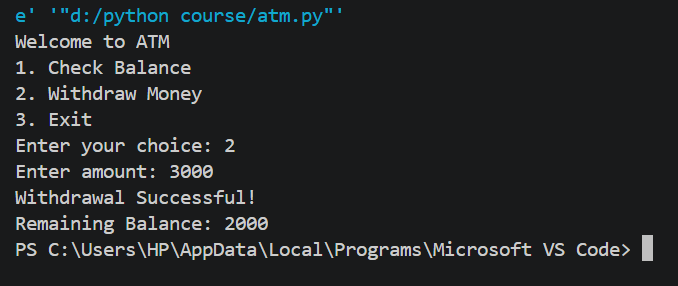

# Python Projects

Welcome to my Python learning journey!

I'm Syed Hassan, a student exploring Python, Cybersecurity, and Agentic AI.

## What You'll Find Here
- Python basics
- Beginner programming projects
- Practical coding exercises

## My Goal
To improve my programming skills by building real-world projects.

More projects coming soon!

## Projects

### 1. Basic ATM System
A beginner-friendly ATM simulation built using Python.

**Features:**
- Check account balance
- Withdraw money
- Basic user interaction

**Technology:** Python

**Status:** Completed

# Python Projects

My Python programming projects and practical learning journey.

## Projects

### 1. Basic ATM System

A beginner-friendly ATM simulation built using Python.

**Features:**
- Check account balance
- Withdraw money
- Basic user interaction

**Technology:** Python

**Status:** Completed

## Project Output

